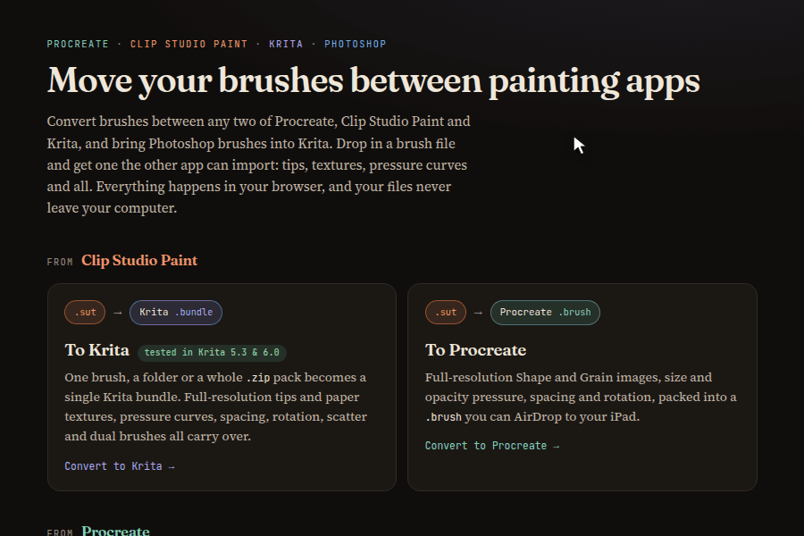

# Brush Converters

Move brushes between Procreate, Clip Studio Paint and Krita, and bring Photoshop brushes into Krita. Drop in a brush file and get one the other app can import. Everything runs in your browser, so your files never leave your computer.



## Converters

| Converter | Drop in | Get | Status |
|---|---|---|---|
| Clip Studio Paint --> Krita | `.sut`, `.zip` pack or folder | `.bundle` | Tested in Krita 5.3 and 6.0 |
| Procreate --> Krita | `.brush`, `.brushset` or `.zip` pack | `.bundle` | Tested in Krita 5.3 and 6.0 |
| Photoshop --> Krita | `.abr` or `.zip` pack | `.bundle` | Tested in Krita 5.3 and 6.0 |
| Clip Studio Paint --> Procreate | `.sut` | `.brush` | Not yet tried in Procreate |
| Krita --> Procreate | `.bundle`, `.kpp`, `.zip` or tip files | `.brush` or `.brushset` | Not yet tried in Procreate |
| Procreate --> Clip Studio Paint | `.brush`, `.brushset` or `.zip` pack | `.sut`, or a `.zip` of several | Experimental: CSP may reject the file |
| Krita --> Clip Studio Paint | `.bundle`, `.kpp`, `.zip` or tip files | `.sut`, or a `.zip` of several | Experimental: CSP may reject the file |

The apps paint with different brush engines, so no conversion is exact. Each converter lists the settings it couldn't carry over, so you know what to tweak.

Curious how the formats work? See the notes on [Clip Studio Paint](docs/csp-internals.md) and [Photoshop](docs/abr-format.md) files.

## Run it

There's nothing to install or build. Serve the folder and open it in a browser:

```sh
python3 -m http.server 8000
```

Then go to <http://localhost:8000>. Opening `index.html` straight from disk won't work, because the pages use ES modules.

## Import your brushes

- **Krita:** Settings --> Manage Resources --> Import Resources, then pick the `.bundle`.
- **Procreate:** AirDrop the file to your iPad, or open it from the Files app.
- **Clip Studio Paint:** File --> Import Sub Tool, one `.sut` at a time. Unzip first if you got a `.zip`.

## AI disclosure

> [!WARNING]
> This project was built with AI. Expect mistakes and keep your original brushes.
>
> The Krita converters were checked by importing their bundles into Krita and painting with the brushes. The files made for Procreate and Clip Studio Paint haven't been tried in those apps.

## License

[MIT](LICENSE)
